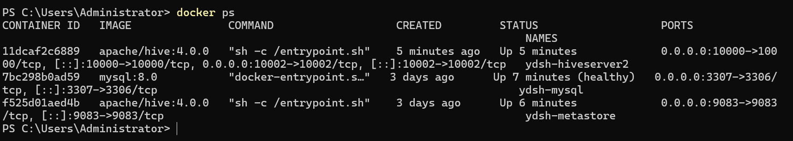
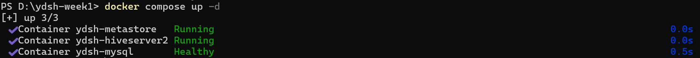
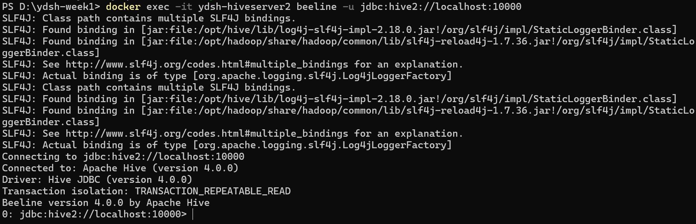
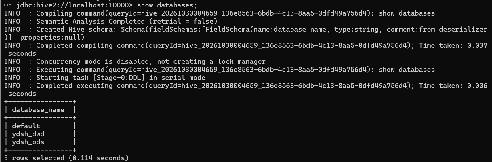
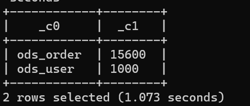
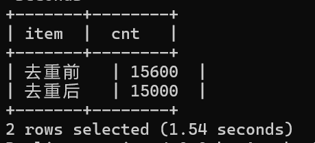
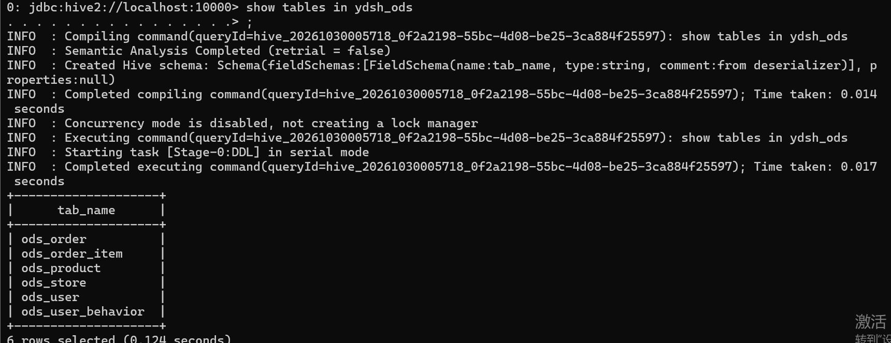

# 环境搭建笔记（第 1 周）

> 记录 Docker / Hive / MySQL / Git 环境搭建过程中遇到的全部问题与解决方案，  
> 对应《部署操作手册》步骤 1~5。所有问题均已在当前环境实际复现并解决。

## 环境清单

| 组件             | 版本/形态                               | 状态             |
| -------------- | ----------------------------------- | -------------- |
| Docker Desktop | Windows + WSL2 backend              | ✅ 可用           |
| MySQL          | mysql:8.0 容器（ydsh-mysql）            | ✅ Up (healthy) |
| Hive Metastore | apache/hive:4.0.0（ydsh-metastore）   | ✅ Up           |
| HiveServer2    | apache/hive:4.0.0（ydsh-hiveserver2） | ✅ Up           |
| Git            | Git-2.56.0.4-64-bit（Windows）        | ✅ 已安装并推送远程     |

**三容器运行状态（docker ps）**：

**docker compose up -d 一键编排启动**：

---

## 问题 1：MySQL 容器启动失败 —— 3306 端口被占用

- **现象**：`docker compose up -d` 后 mysql 容器退出，日志报 `bind: Only one usage of each socket address`。
- **原因**：宿主机 3306 已被其他服务占用。
- **解决**：`docker-compose.yml` 中把宿主机侧端口映射改为 `3307:3306`（容器内仍是 3306）。  
  metastore 走容器网络 `mysql:3306` 连接，不受宿主机端口影响。
- **验证**：`docker ps` 显示 `0.0.0.0:3307->3306/tcp`，容器 Up (healthy)。

## 问题 2：beeline 连接被拒（Connection refused，秒断）

- **现象**：三容器都是 Up，但 `beeline -u jdbc:hive2://localhost:10000` 立刻报 Connection refused。
- **原因**：HiveServer2 启动需要时间（先等 Metastore 就绪再起 Thrift 服务），容器 Up ≠ 服务就绪；  
  且 hive-server 未配置 metastore 地址，HS2 找的是自己容器里的 9083（空的）。
- **解决**：
  1. 等待 30~60 秒再连，或看 `docker logs ydsh-hiveserver2` 出现 "HiveServer2" 就绪日志；
  2. `docker-compose.yml` 给 hive-server 加：  
     `SERVICE_OPTS: "-Dhive.metastore.uris=thrift://hive-metastore:9083"`。

**beeline 连接成功**：

## 问题 3：Derby 误初始化 —— 元数据落在容器本地，重建即丢

- **现象**：日志中出现 schematool 用内嵌 Derby 初始化元数据库；建的库表在容器重建后消失。
- **原因**：apache/hive 镜像入口脚本默认首次运行会做 Derby 初始化。
- **解决**：hive-server 增加环境变量 `IS_RESUME: "true"`，跳过初始化、直接以"恢复"模式启动；  
  元数据统一走 MySQL 支撑的远程 Metastore（持久化）。
- **验证**：`CREATE DATABASE ydsh_ods` 后重启容器，库仍在。

**容器重建后库表依旧存在（元数据持久化验证）**：

## 问题 4：beeline `!run /data/sql/...` 报 No such file or directory

- **现象**：在 beeline 内执行 `!run /data/sql/ods/create_ods.sql` 找不到文件。
- **原因**：宿主机的 `./sql` 目录没有挂载进 hive-server 容器。
- **解决**：`docker-compose.yml` 的 hive-server volumes 增加 `- ./sql:/sql`（data 同理 `- ./data:/data`）；  
  beeline 内用 `!run /sql/ods/create_ods.sql`，或宿主机一次性执行：  
  `docker exec -it ydsh-hiveserver2 beeline -u jdbc:hive2://localhost:10000 -f /sql/ods/create_ods.sql`。

## 问题 5：Hive 不支持 LEFT ANTI JOIN

- **现象**：质量评估 SQL 中 `LEFT ANTI JOIN` 语法报错。
- **解决**：改写为 Hive 原生等价写法 `LEFT JOIN ... WHERE 右表.主键 IS NULL`（共改 3 处）。

## 问题 6：系统没有 Git 命令

- **现象**：PowerShell 提示 `git` 无法识别。
- **原因**：Windows 系统未安装 Git。
- **解决**：通过国内镜像（npmmirror）下载 `Git-2.56.0.4-64-bit.exe`（注意：补丁号在文件名里，别按版本号猜文件名），  
  静默安装：`& "安装包路径.exe" /VERYSILENT /NORESTART`，装完重开终端 `git --version` 验证。

## 问题 7：Git 推送前置 —— SSH 密钥与远程配置

- **步骤**：
  1. `git config --global user.name "yuyu41-sg"`、`git config --global user.email "1950717288@qq.com"`；
  2. `ssh-keygen -t ed25519 -C "1950717288@qq.com"`，把 `~/.ssh/id_ed25519.pub` 公钥添加到 GitHub/GitLab 的 SSH Keys；
  3. `git remote add origin <仓库地址>` → `git push -u origin main`。
- **结果**：`* [new branch] main -> main`，远程可见首次提交，队友可 `git clone`。

---

## 数据导入与清洗验证（截图）

**ODS 行数校验**（ods_order 15600 / ods_user 1000，与数据字典一致）：

**订单去重闭环**（15600 → 15000，removed=600 与质量评估吻合）：

**ODS 六张表清单**（show tables in ydsh_ods）：

---

## 经验小结

1. **容器 Up ≠ 服务就绪**：带依赖的服务（HS2 依赖 Metastore 依赖 MySQL）要留启动时间，用 `docker logs` 确认。
2. **元数据与数据分开看**：元数据在 MySQL（持久），表数据在 hive-server 容器本地盘——重建容器后重跑导入脚本即可补回数据。
3. **端口冲突**优先改映射端口，不要动容器内端口。
4. **CSV 导入三件套**：`ROW FORMAT DELIMITED FIELDS TERMINATED BY ','` + `skip.header.line.count='1'` + 行数校验。
